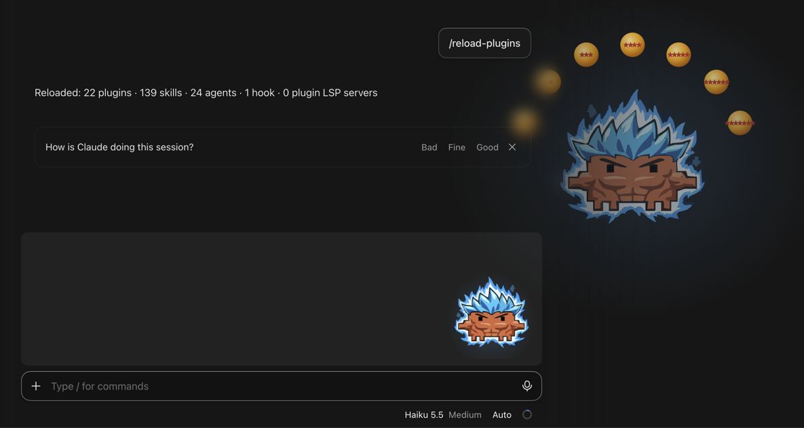
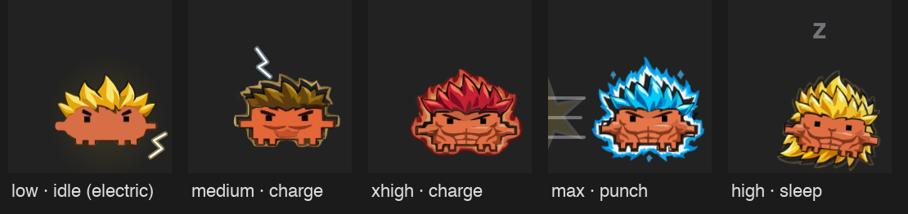
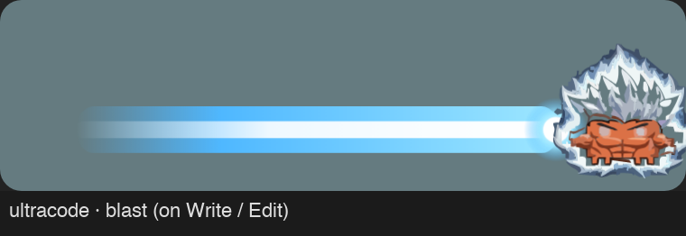

# Claude Code Dragonball


A theme pack for Claude Code: black with Claude orange, dragon-ball gold accents, power-up spinner verbs ("Charging ki", "Going Super", "Breaking the limit"…) and a few tips. Made for the Claude Code desktop app and the CLI; each has its own section below. The iTerm2 IDE layout lives in [claude-ide-dragonball](https://github.com/cyrus5x89/claude-ide-dragonball).

## Claude desktop app



The plugin is a mod for the Code tab, built like Anthropic's `theme-examples` plugin: a black backdrop with seven dragon balls and Claude powering up behind the chat, plus a small animated Claude just above the prompt box. Both follow the effort level of each turn (low → ultracode).

**Install** (type these in the app's prompt box):

```
/plugin marketplace add cyrus5x89/claude-code-dragonball
/plugin install dragonball@claude-code-dragonball
/reload-plugins
```

Then send any message: the backdrop and the pet appear with the first turn.

**Update:** `/plugin marketplace update claude-code-dragonball`, then `/plugin update dragonball@claude-code-dragonball` and `/reload-plugins`.

**Commands:**

- `/dragonball` follows the effort level (default)
- `/dragonball max` pins one level (`low`, `medium`, `high`, `xhigh`, `max`, `ultracode`)
- `/dragonball off` turns the backdrop and the pet off
- `/dragonball fps 12`, `24` (default) or `60`: frame rate of every animation; lower costs less GPU

**The pet.** Each mascot is split into three layers (ki aura, hair, body) that move on their own: the body breathes, the hair sways a beat later, the aura pulses. Low and medium have no aura of their own, so electricity crackles around them instead.



- **idle**: breathing; after 90 s idle it falls asleep (head down, Zzz)
- **charge** while Claude works: hair stands up and trembles, the aura surges, lightning from medium up, rocks lift off the ground
- **punch** on each read, search or command: two jabs, the hair whips back, impact bursts
- **blast** on each Write / Edit: gathers ki, then fires a beam across the bar



**Limits:** the app wraps the pet in its own grey card, as wide as the prompt box; a mod can draw only inside it. The app also refuses images in a backdrop, so the mascots are traced to vector paths by `make_scenes.py` into `hooks/scenes.ts`.

## CLI (terminal)

The CLI gets the colours and the power-up text; the backdrop and the animated pet are desktop-app only (the terminal cannot draw SVG).

```sh
git clone https://github.com/cyrus5x89/claude-code-dragonball && ./claude-code-dragonball/install.sh
```

`install.sh` follows Claude Code's custom theme format: it copies `themes/dragonball.json` to `~/.claude/themes/`, sets `"theme": "custom:dragonball"` and merges the spinner verbs and tips from `settings.json` into `~/.claude/settings.json` (backup at `~/.claude/settings.json.bak-dragonball`). Restart `claude` to see it.

Colours only: copy `themes/dragonball.json` into `~/.claude/themes/` and pick **Claude Dragonball** in `/theme`. Also submitted to the [ccthemes gallery](https://github.com/livlign/ccthemes/pull/4).

For the iTerm2 IDE layout (preview pane, Saiyan watermark per effort level) see [claude-ide-dragonball](https://github.com/cyrus5x89/claude-ide-dragonball).

## What changes

| | |
|---|---|
| `themes/dragonball.json` | Theme (dark base): orange Claude accent, gold shimmer, yellow permission prompts, blue plan mode, red fast mode, white ultra effort, soft green/red diff tints, matching subagent colours |
| `spinnerVerbs` | Power-up verbs replace the built-in ones |
| `spinnerTipsOverride` | Tips labelled ❶ |

## Limits

- The pixel Clawd in the terminal welcome header cannot be changed; in the desktop app the mascot lives in the backdrop instead.
- The CLI and the desktop app read the same `~/.claude/settings.json`, so the theme applies to both.
- The pet and backdrop need a desktop app version that draws mod backdrops (tested on 2.1.326).
