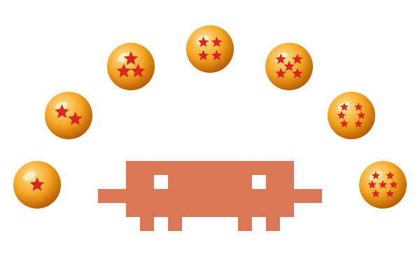

# Claude Code Dragonball



A theme pack for Claude Code: black with Claude orange, dragon-ball gold accents, power-up spinner verbs ("Charging ki", "Going Super", "Breaking the limit"…) and a few tips. Made for the Claude Code desktop app and the CLI. The iTerm2 IDE layout lives in [claude-ide-dragonball](https://github.com/cyrus5x89/claude-ide-dragonball).

## Install

```sh
git clone https://github.com/cyrus5x89/claude-code-dragonball && ./claude-code-dragonball/install.sh
```

The script installs the plugin (which ships the theme) and merges `settings.json` into `~/.claude/settings.json`, keeping a backup at `~/.claude/settings.json.bak-dragonball`. Restart Claude Code afterwards.

Plugin only: `/plugin marketplace add cyrus5x89/claude-code-dragonball`, `/plugin install dragonball@claude-code-dragonball`, then pick **Claude Dragonball** in `/theme`. Spinner verbs and tips are settings, not plugin parts, so copy them from `settings.json` yourself.

## What changes

| | |
|---|---|
| `themes/dragonball.json` | Theme: orange Claude accent, gold shimmer, yellow permission prompts, blue plan mode, red fast mode, white ultra effort |
| `spinnerVerbs` | Power-up verbs replace the built-in ones |
| `spinnerTipsOverride` | Tips labelled ❶ |

## Limits

- The pet / mascot cannot be changed: Claude Code has no setting for it.
- The CLI and the desktop app read the same `~/.claude/settings.json`, so the theme applies to both.
- Whether the desktop app draws custom themes and spinner verbs is not documented; tested so far in the CLI only.
